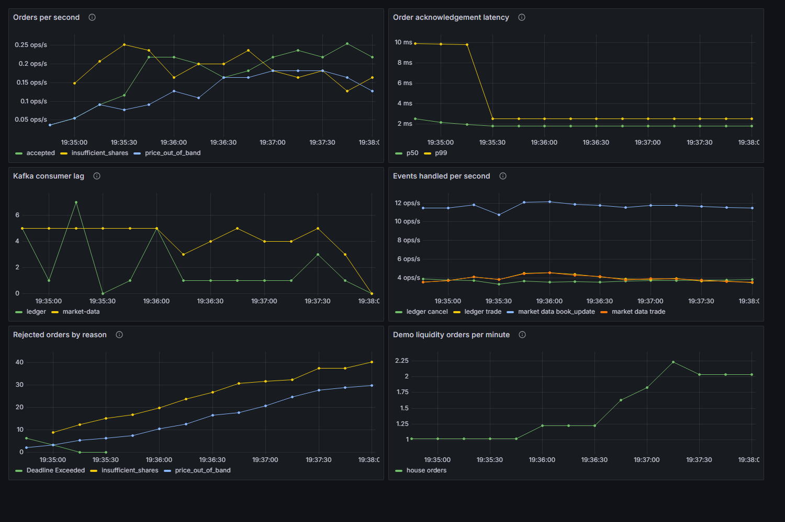

# Maroof Street: A Distributed Stock Exchange


A mini stock exchange for AAPL, TSLA, NVDA, MSFT and GOOGL, built around my [C++ matching engine](https://github.com/smhussa22/matching-engine). Orders come in over gRPC, pass pre-trade risk checks, are written to a Kafka log, matched by one engine per stock, and settled by a ledger. Five bots written in four languages trade against each other, and a public demo lets anyone place an order and watch it travel through the system.

**Live demo:** [syedmaroofhussain.com/maroof-street](https://syedmaroofhussain.com/maroof-street)

## How It Works (Brief Summary)

```
 website visitor                         trading bots (Python, Go, Rust, Java)
        |                                              |
        v                                              |
  HTTP gateway (FastAPI)                               |
  validation, per-visitor wallet, rate limit           |
        |                                              |
        +--------------------+-------------------------+
                             v
                  order gateway (C++, gRPC)
          API key, rate limit, balance reservation (Redis Lua)
                             |
                             v
              Kafka   commands.AAPL ... commands.GOOGL
                             |
                             v
        engine host x 5 (C++), one per stock, lock-free order book
                             |
                             v
              Kafka   events.AAPL ... events.GOOGL
                    |                         |
                    v                         v
            ledger (Python)           market data (Python)
        settles cash and shares       book, trades, ticker, gRPC streams
            Postgres + Redis                  Redis
```

- **One engine per stock.** Each engine is a single-threaded matching core with a lock-free limit order book, so there is no locking on the hot path and stocks scale independently.
- **The log is the source of truth.** Every accepted order is written to Kafka before anything acts on it. When an engine restarts it replays its command log and rebuilds the exact same book without republishing old events.
- **Risk before matching.** The order gateway checks the API key and a token-bucket rate limit, then reserves cash (buys) or shares (sells) with atomic Redis Lua scripts. A rejected order never reaches an engine.
- **Settlement is separate from matching.** The engine only emits events (accepted, filled, cancelled). The ledger reads them, moves money and shares between accounts, and gives back any reserved cash a better fill did not use.

### Order types

- **GTC** (good till cancelled): rests in the book at its price until it matches.
- **FAK** (fill and kill): matches what it can immediately and cancels the rest.

### The public demo

- Each website visitor gets an anonymous wallet ($100,000 to start) kept apart from every other visitor's.
- Demo orders always complete: whatever the real book cannot fill, a house account takes at the visitor's price, so every visitor sees a full trip through the exchange.
- The website always has a market to show. When the real exchange is switched off, the page runs a simulated market around the clock: prices, book depth and bot trades are generated from the clock, and visitor orders are matched in the simulation. It is labelled "Simulated market", and the fills are marked simulated. When the real exchange is up, the page shows it instead.
- After an order is placed, the page shows the steps it went through with real timestamps and highlights the order in the book and the live activity feed.

## Benchmarks

### Matching engine on its own

Measured in the [matching-engine](https://github.com/smhussa22/matching-engine) repository (10M commands, single thread).

| Metric | Result |
|---|---|
| Throughput | 58.65M orders/s |
| p50 | 20 ns |
| p99 | 225 ns |
| p99.9 | 502 ns |

With the Kafka publisher attached to the engine, 99.9% of orders still match in under 1 µs.

### End to end through the real system

From the moment a `SubmitOrder` call leaves the client to the moment the matching fill event arrives on Kafka. This covers the order gateway (auth, rate limit, fund reservation), the Kafka command hop, the match, and the Kafka event hop. 1,000 orders over loopback on one machine (`scripts/latency_bench.sh`).

| Metric | Result |
|---|---|
| p50 | 2.9 ms |
| p99 | 4.7 ms |

Setting the Kafka producer's `linger.ms` from its 5 ms default to 0 took p99 from 13.4 ms to about 4.7 ms; batching had been most of the latency.

### Correctness and recovery

`scripts/resilience_check.sh` runs these against a real Kafka, Redis, Postgres, engine, gateway and ledger:

| Check | Result |
|---|---|
| 40 trades with cancelled remainders: total cash and shares across all accounts | unchanged (conserved) |
| Engine killed with SIGKILL and restarted: orders resting before the crash | both still matched |
| Total cash and shares after recovery | unchanged (conserved) |

## Monitoring

The HTTP gateway, ledger and market-data service export Prometheus metrics. A Grafana dashboard is provisioned automatically.

| Metric | What it shows |
|---|---|
| `exchange_orders_total{result}` | Visitor orders by outcome: accepted, or the reason they were refused |
| `exchange_submit_seconds` | How long the order gateway takes to answer a submitted order |
| `exchange_consumer_lag{service}` | Events waiting to be read by the ledger or market data. Zero means they are keeping up |
| `ledger_events_total{kind}` | Trades, cancels and rejects the ledger handled |
| `market_data_events_total{kind}` | Trades and book updates the market-data service handled |
| `exchange_house_orders_total` | Orders the house account placed to complete visitor orders |

```bash
# next to a running ./start dev:
docker-compose -f deploy/docker-compose.yml --profile monitoring up -d prometheus grafana
# Grafana:    http://localhost:3000   (dashboard "Maroof Street", editable)
# Prometheus: http://localhost:9090

# or with the containerised stack:
EXCHANGE_PROXY_SECRET=change-me docker compose -f deploy/docker-compose.prod.yml --profile monitoring up -d
```



The dashboard has six panels: orders per second by outcome, order acknowledgement latency (p50 and p99), consumer lag, events handled per second, rejected orders by reason, and house orders per minute. It is provisioned from `deploy/monitoring` and can be edited in the Grafana UI. The C++ gateway and engine do not export metrics yet.

## Build & Run

Requires Docker, CMake, a C++23 compiler, and `libgrpc++`, `libprotobuf`, `librdkafka`, `libhiredis` and `libpq` development packages.

```bash
cmake -B build -DCMAKE_BUILD_TYPE=Release && cmake --build build
scripts/gen-python-proto.sh

./start dev        # Kafka, Redis, Postgres, five engines, gateways, ledger, market data and all five bots
./start stop       # closing bell: stop intake, let the ledger catch up, record the session, tear down

scripts/latency_bench.sh      # end-to-end latency
scripts/resilience_check.sh   # money conservation and crash recovery
```

Run everything in containers on one machine (Kafka and Redis keep their data in volumes):

```bash
EXCHANGE_PROXY_SECRET=<long random string> docker compose -f deploy/docker-compose.prod.yml up -d --build
```

To let the website talk to it, expose the HTTP gateway (port 8080) through a Cloudflare Tunnel (`./start tunnel`) and set `EXCHANGE_URL` and `EXCHANGE_PROXY_SECRET` on the website.

If Docker cannot publish Postgres on 5432 on Windows (the port can fall inside a range Windows reserves), set `POSTGRES_PORT` to something else, for example `15432`.

## Status

Kubernetes manifests exist for every component, but the system has not been deployed to a cluster, and balances are held in Redis, not yet written back to Postgres. Trading bots use fixed reference prices, not a live market feed. The full checklist is in [progress.md](progress.md).

## Repositories That Helped

- [matching-engine](https://github.com/smhussa22/matching-engine): the C++ limit order book this exchange is built around.
- [maroof-net](https://github.com/smhussa22/maroof-net): the reliable UDP transport the engine's standalone server uses.
